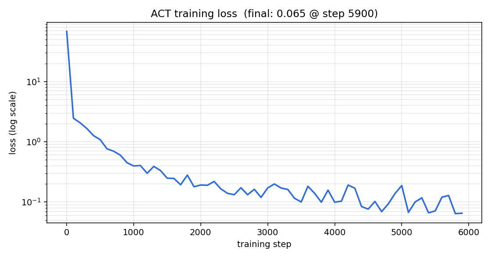

# ブロック押しタスクの模倣学習

Physical AI 応用1 最終課題 / omnicampus: __ACCOUNT__

## 1. 課題の概要

ロボットアーム CRANE+ V2 が、机の上に置かれた赤いブロックを、少し離れた目標エリアまで
押して移動させるタスクを設定した。シミュレータは ROS 2 Humble + Gazebo（Ignition Fortress）、
制御方策は ACT（Action Chunking with Transformers）による模倣学習で獲得した。

人がプログラムした軌道をそのまま再生するのではなく、**自動生成したデモ20エピソードから
方策を学習し、学習した方策が関節状態だけを見て押し動作を再現する**ところまでを一連で行う。

| 項目 | 内容 |
|---|---|
| ロボット | CRANE+ V2（4自由度アーム＋グリッパ） |
| 対象物 | 4cm角のブロック（質量80g、摩擦係数0.45） |
| 開始位置 | ロボット基部から半径0.14m・方位 −20° |
| 目標エリア | 同 半径0.14m・方位 +23°（8.5cm角の緑マーカー） |
| 成功判定 | ブロック中心が目標エリア中心から4cm以内 |
| AIの使用 | ACT による模倣学習（学習あり） |

## 2. 目的

講義（第4・5回）では、CRANE+ V2 に「お辞儀」をさせる模倣学習を体験した。
お辞儀は環境に働きかけない動作であり、方策が多少ずれても結果は変わらない。
そこで本課題では、**環境（物体）の状態を変化させるタスク**に変更し、
方策の精度がそのままタスクの成否に反映される設定で、同じパイプラインがどこまで通用するかを確かめることを目的とした。

## 3. システム構成

```
自動デモ生成 → rosbag2 記録 → LeRobotDataset 変換 → ACT 学習(GPU) → Gazeboで実行
```

すべて 1 つの Docker コンテナ（ROS 2 Humble + Gazebo + LeRobot）内で完結する。
実行環境は NVIDIA RTX 3060（12GB）／Windows 11 + Docker Desktop（WSL 2 backend）。

### 3.1 タスク環境

机とブロック、目標エリアを配置した専用ワールド `push_task.sdf` を作成した。
講義のワールドが参照していた Gazebo Fuel のブロックモデルは、ソフトウェア描画の環境で
テクスチャが読めず真っ黒に表示されたため、色と物理パラメータを明示した自前のブロックに置き換えた。
MoveIt と RViz は本課題では不要なので起動しない構成とし、シミュレータを軽くしている。

### 3.2 押し動作の設計

CRANE+ V2 の URDF からリンク長（肩〜肘 0.083 m、肘〜手先 0.0935 m、基部〜肩 0.0714 m）を読み、
**平面2リンクの逆運動学**を実装した。手先位置を「作業半径 R・高さ H」で指定でき、
joint4 でグリッパを常に真下へ向ける。押し動作は次の5段階からなる。

1. 直立から、ブロック手前の上空（半径0.14 m、高さ0.19 m）へ移動
2. グリッパ先端が天板すれすれになる高さ（0.142 m）まで下ろす
3. joint1（旋回）を −0.60 rad から +0.46 rad までゆっくり回し、ブロックを円弧状に押す
4. 手先を持ち上げる
5. 直立に戻る

手先の高さは試行で決めた。グリッパを真下に向けたとき、手先原点が高さ約 0.131 m で
指先が天板に接触する。0.142 m はその 1 cm 上で、4 cm のブロックの側面を確実に捉えられる。

### 3.3 データ収集

`auto_demo_push.py` が上記の軌道を生成し、講義のテレオペと同じトピック・同じ 20 Hz で
関節指令を出しながら rosbag2 に記録する。したがって出力は手集めのデータと同じ形式になり、
講義の変換・学習スクリプトをそのまま使える。エピソードごとに

- 押し始めの旋回角 −0.64 〜 −0.56 rad
- 押し終わりの旋回角 +0.42 〜 +0.50 rad
- 手先の高さ 0.140 〜 0.145 m
- 押す時間 2.6 〜 3.4 s

を乱数で変え、毎回ブロックを Gazebo の `set_pose` サービスで開始位置へ戻す。
記録後にブロック位置を読み、目標エリアからの距離で成否を自動判定する。

収集結果: **20エピソード中 19 回成功**（成功分の目標中心からの距離は平均 1.37 cm、最大 2.7 cm）。
失敗した 1 回は押し始めの旋回角が浅く、グリッパがブロックの脇を通り抜けたものである。
失敗エピソードも含めてそのまま学習に用いた。

### 3.4 学習

LeRobotDataset へ変換（20エピソード・計 4080 フレーム、20 Hz）したうえで、
ACT 方策を学習した。観測・行動はいずれも 5 次元（4関節＋グリッパ）で、画像は使っていない。

| 設定 | 講義デフォルト | 本課題 |
|---|---|---|
| training_steps | 200 | 6000 |
| batch_size | 2 | 16 |
| chunk_size | 16 | 32 |
| n_action_steps | 1 | 8 |
| action の delta_timestamps | −0.1〜1.4 s（16点） | 0〜1.55 s（32点） |

学習時間は RTX 3060 で約 9 分、最終損失は 0.065 であった（損失曲線は図1）。



## 4. 結果

学習した方策を Gazebo 上で 10 回試行した。各試行の前にアームを直立へ戻し、
ブロックを開始位置へリセットして条件をそろえ、方策が指令を出し始めてから 15 秒間だけ制御させた。

| 試行 | ブロック最終位置 (x, y) [m] | 目標中心からの距離 | 判定 |
|---|---|---|---|
| 1 | (0.1295, 0.0664) | 1.17 cm | 成功 |
| 2 | (0.1276, 0.0755) | 2.08 cm | 成功 |
| 3 | (0.1335, 0.0729) | 1.88 cm | 成功 |
| 4 | (0.1490, 0.0675) | 2.39 cm | 成功 |
| 5 | (0.1339, 0.0796) | 2.54 cm | 成功 |
| 6 | (0.1478, 0.0664) | 2.23 cm | 成功 |
| 7 | (0.1507, 0.0676) | 2.53 cm | 成功 |
| 8 | (0.1391, 0.0798) | 2.71 cm | 成功 |
| 9 | (0.1302, 0.0722) | 1.75 cm | 成功 |
| 10 | (0.1476, 0.0661) | 2.19 cm | 成功 |

**成功率 10/10、目標中心からの平均誤差 2.15 cm**（最小 1.17 cm、最大 2.71 cm）。
目標エリアは 8.5 cm 角なので、いずれの試行でもブロックは完全にエリア内へ収まった。

デモ自体の平均誤差 1.37 cm に対して方策は 2.15 cm とやや大きいが、
これは方策が複数のデモの平均的な軌道を再現しているためと考えられる。
一方で、デモに 1 回含まれていた失敗（ブロックに触れずに空振り）は方策側では再現されず、
10 試行とも安定して押し切った。

## 5. 工夫した点

- **講義の「お辞儀」から、物体に接触して環境を変えるタスクへ発展させた。**
  成否が物体の位置で客観的に測れるため、方策の良し悪しが定量評価できる。
- **逆運動学を実装し、軌道を「半径・高さ・向き」で指定できるようにした。**
  講義のデモは関節角の直打ちだったが、これにより押す高さや作業半径を1行で変えられ、
  手先がテーブルに接触する限界高さの探索もすぐに行えた。
- **データ収集を完全に自動化した。** ブロックの自動リセット、パラメータのランダム化、
  目標到達判定までをスクリプト化し、20エピソードを無人で収集できるようにした。
  手作業のテレオペに比べ、デモ品質のばらつきが小さく、失敗エピソードの混入も避けられる。
- **学習設定をタスクに合わせて見直した。** 講義デフォルトの 200 step / chunk 16 では
  11 秒の長い軌道を再現できず、途中で停止したり往復したりした。行動チャンクを 32 点
  （1.55 秒分）に伸ばし、step 数を 6000 に増やすことで安定して完走するようになった。
- **デモの開始姿勢と終了姿勢を別のものにした。** 最初は講義のお辞儀デモにならって
  「直立 → 押す → 直立に戻る」という軌道でデモを収集したが、学習した方策は直立のまま
  動かなかった。関節状態だけを観測する方策にとって、直立は「これから押す」状態と
  「押し終わった」状態の両方に対応してしまい、行動が平均化されて動かなくなる。
  そこで軌道の終端を「目標エリア上空で静止」に変更し、開始姿勢と終了姿勢を
  区別できるようにしたところ、直立から確実に押し動作を開始するようになった。
- **撮影を前提に環境を整えた。** 3Dビューだけを表示する GUI 設定とカメラ位置を用意し、
  コンテナ内の ffmpeg で画面録画から字幕付き動画の組み立てまでスクリプト化した。

## 6. 考察と今後の課題

本方策は関節状態のみを観測とするため、**ブロックの初期位置が変わると対応できない**。
今回はブロックを常に同じ位置へリセットしており、方策が学習しているのは事実上
「どの関節状態のとき次にどう動くか」という時系列の再現である。

実用性を考えるなら、カメラ画像を観測に加えた視覚条件付きの方策へ拡張し、
ブロック位置をランダム化したデータで学習する必要がある。CRANE+ のパッケージには
カメラ用の URDF と色検出のサンプルが含まれているため、同じパイプラインの延長で実装できる見込みである。

また、押す動作は接触の摩擦に依存するため、摩擦係数や質量を変えたときの頑健性も
検証すべき点として残っている。

## 7. 提出物

- コード（GitHub）: __REPO_URL__
- 動画（YouTube）: __VIDEO_URL__
